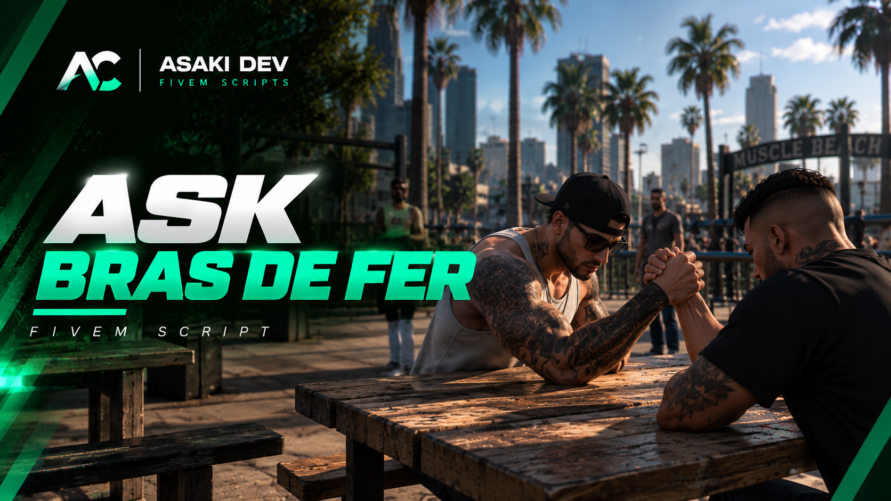

# 🟢 ASK BRAS DE FER — Free FiveM Script

**ASK BRAS DE FER** est un script de bras de fer multijoueur gratuit.

## ⚙️ Fonctionnalités principales

- 💪 **Duels multijoueurs** : affrontez un autre joueur dans un bras de fer interactif.
- 🪑 **Tables fixes et portables** : installez des tables où vous le souhaitez.
- 🎮 **Animations synchronisées** : animations natives GTA V pour les deux participants.
- ⏱️ **Durée configurable** : personnalisez la durée des duels selon vos préférences.
- 🎨 **Interface moderne** : design sombre avec des accents verts, aux couleurs d'AC STUDIO.
- 🌍 **Multilingue** : disponible en français et en anglais (FR/EN).
- 🔧 **Standalone** : aucun framework obligatoire.
- 📦 **Intégrations facultatives** : prise en charge de `ox_inventory` et `ox_target`.

## 🔌 Compatibilité

Le script fonctionne en **Standalone**, sans nécessiter ESX, QBCore ou Qbox.

Les intégrations avec les ressources suivantes sont facultatives :

- `ox_inventory` — Gestion des tables portables.
- `ox_target` — Interactions avec les tables.

## 📥 Téléchargement

🟢 **ASK BRAS DE FER est entièrement GRATUIT !**

Vous pouvez récupérer le script directement depuis ce dépôt GitHub.

Pour toute question, assistance ou demande particulière, rejoignez notre communauté Discord et ouvrez un ticket.

💬 **Discord :** https://discord.gg/5CkZQcYvwK

## 📺 Démonstration vidéo

Découvrez le fonctionnement du script en vidéo :

🎬 **YouTube :** https://www.youtube.com/watch?v=9EIEz1-hwKA

## 💚 Support & développement

Vous rencontrez un problème ou souhaitez proposer une amélioration ?

N'hésitez pas à nous contacter via Discord.

---

**AC STUDIO FIVEM 🟢**
